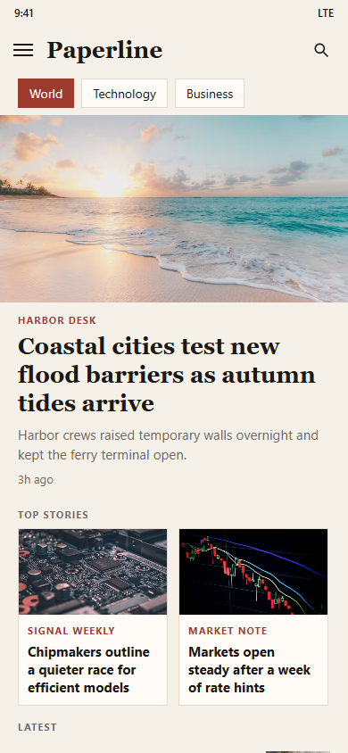
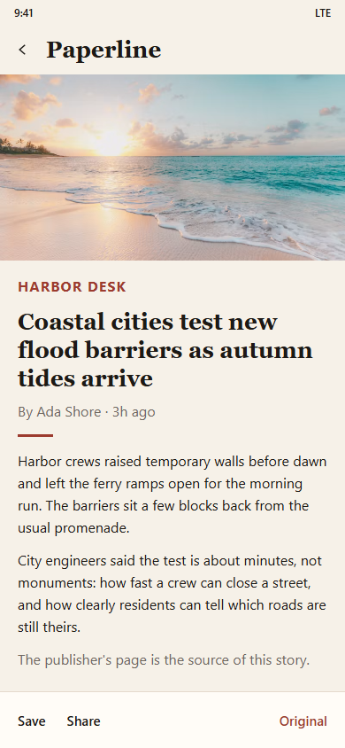
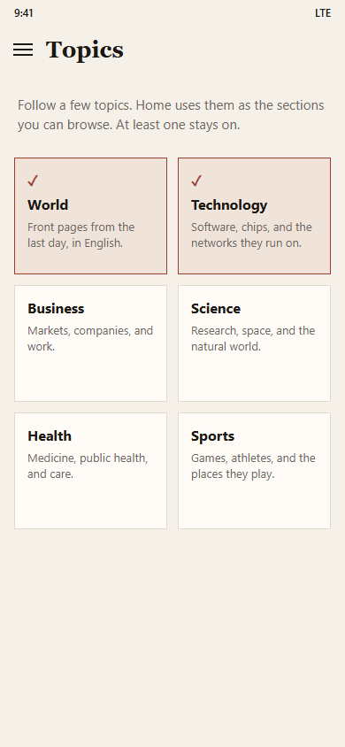

# Paperline

Paperline is a news reader for Android, built with Jetpack Compose. The app has the same three places as the [JetNews](https://github.com/android/compose-samples/tree/main/JetNews) sample: a home feed, an article, and a topics screen. A drawer moves between them on a phone. A wide window shows the list and the article side by side.

JetNews ships a fixed set of posts. Paperline loads live English headlines from a public news API, with no key to paste in.

## Screenshots

| Home | Article | Topics |
| --- | --- | --- |
|  |  |  |

## What you can do

- Read a lead story, a sideways row of top stories, and the rest of the latest list.
- Switch the feed with topic chips: World, Technology, Business, Science, Health, Sports, Climate, Politics, and Culture.
- Search headlines from the top bar.
- Open a story, save it on the device, share it, or jump to the publisher's page.
- Pull to refresh, and keep reading the last saved feed when the network fails.
- Use the light paper theme or the dark theme that follows the system.

## News source

Headlines come from the [Free News API](https://freenewsapi.ai/). It is a public search index: no signup and no API key. Paperline asks for English stories, then opens the original article URL when you want the publisher's page. Article text in the app is the text the index stored. The publisher's page is the source of the story.

## Project map

```
app/src/main/java/com/paperline/news
  data/        articles, topics, the news client, bookmarks, and the feed cache
  ui/home      the feed
  ui/article   one story
  ui/interests topics to follow
  ui/saved     stories kept on the device
  ui/theme     the paper and ink colors
```

## Build

Open the project in Android Studio (JDK 17, Android SDK 35) and run the `app` configuration.

From a terminal, with `JAVA_HOME` pointed at a JDK 17 or newer:

```bash
./gradlew :app:assembleDebug
./gradlew :app:testDebugUnitTest
```

## License

Apache License 2.0. See [LICENSE](LICENSE) and [NOTICE](NOTICE).

The screen structure is inspired by JetNews, Copyright 2021 The Android Open Source Project, also under the Apache License 2.0. Paperline's copy, theme, and networking are separate from that sample.
